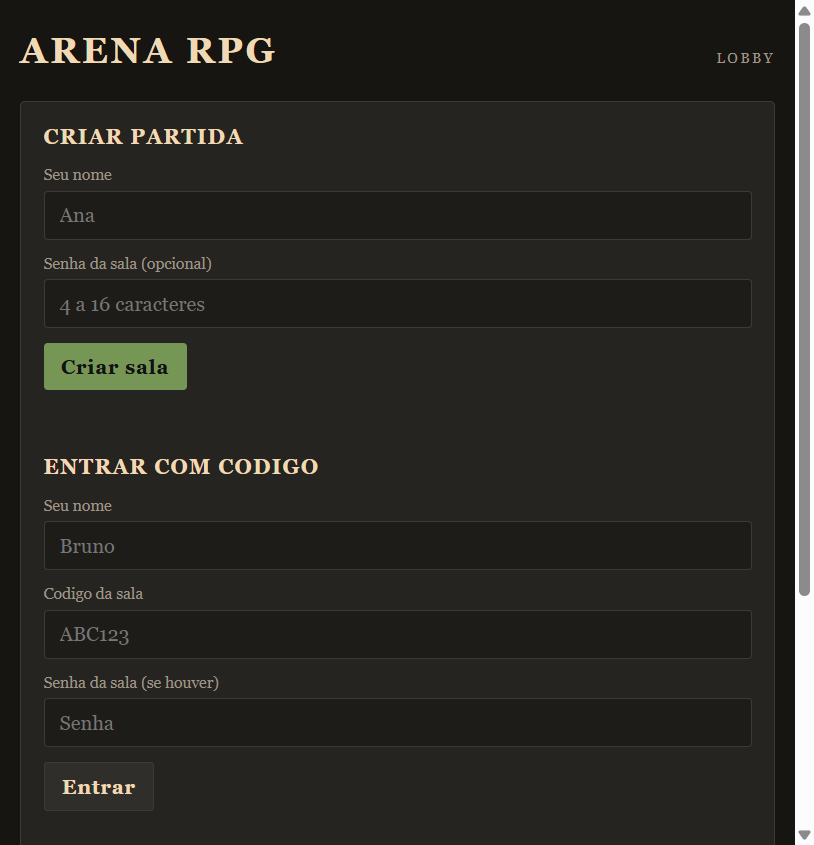
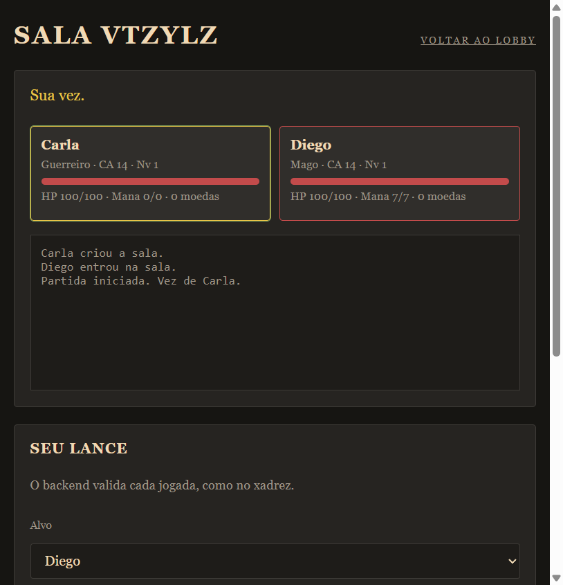

# Arena RPG 5e

RPG de arena por turnos, no estilo 5e, para partidas locais entre amigos. Dá para jogar no terminal, no lobby web ou por TCP na mesma rede.

## 🚀 Demo

Não há deploy público. A partida roda na sua máquina ou na rede interna:

- Lobby web: [http://127.0.0.1:8000](http://127.0.0.1:8000)
- Servidor TCP: `127.0.0.1:5000`





## 🛠️ Tecnologias

- Python 3.10+ (biblioteca padrão)
- HTTP + SSE para o lobby web (`web/`)
- HTML, CSS e JavaScript no `frontend/`
- TCP com mensagens JSON para o modo online (`online/`)
- `unittest` e Ruff no CI

## ✨ Funcionalidades

- Motor de combate devolve eventos JSON; o terminal, o lobby e a arena 3D só exibem
- Todo mundo começa como aventureiro; a diferença vem da passiva (Bruto, Arcano ou Preciso), da loja e do nível
- Combate por turnos com ataque, magia, loja e inventário
- Arena 3D opcional (Three.js) e modo co-op contra chefe
- Armadura com redução de dano e durabilidade
- Eventos aleatórios (tesouro, aposta, risco e monstros)
- Lobby web com salas, senha opcional e no máximo 6 jogadores
- Sessão por token: só o anfitrião inicia, e cada jogador age pela própria identidade
- Servidor TCP com reconexão após reinício
- Partida no terminal para um grupo no mesmo computador

## ⚔️ Aventureiro

A ficha base é a mesma. No lobby cada um escolhe **uma passiva** (não é classe): isso muda o começo, não trava o resto da partida. No nível 3 as outras magias de dano também desbloqueiam.

| Passiva | HP | Mana | Traço | Magias iniciais |
| --- | --- | --- | --- | --- |
| Bruto | 115 | 3 | Redução 1 | Cura Leve, Golpe de Energia |
| Arcano | 90 | 6 | +1 mana/rodada | Cura Leve, Bola de Fogo |
| Preciso | 100 | 4 | +1 acerto, crítico 19 | Cura Leve, Rajada Congelante |

No co-op o chefe mira o mais ferido na maior parte das vezes, usa Pisada a cada três turnos e avança até 3 ondas.

## 🎲 Combate

- O ataque rola `d20 + bônus de ataque` contra a CA do alvo.
- Em acerto, o dano usa `d10 + bônus`. Crítico (20) dobra o dano.
- Armadura reduz dano e perde durabilidade; cura não ressuscita eliminado.
- Acerto concede 25 de XP. Há 1/3 de chance de ganhar moedas (como no terminal).
- Magias gastam mana. Bola de Fogo causa 18, Rajada 12 e Cura Leve recupera 15, mais o bônus de dano.

## 🔒 Rede

HTTP e TCP trafegam **sem TLS**: senha e token vão em texto se a rede não for confiável. Use `127.0.0.1` ou um proxy HTTPS. A senha da sala é guardada com hash, a entrada tem limite de tentativas e as mensagens TCP têm teto de tamanho.

## 📦 Como rodar localmente

```bash
git clone https://github.com/thiagokuster/RPG_game.git
cd RPG_game
```

Não precisa instalar dependências extras. Use o Python 3.10 ou superior.

### Lobby web (recomendado para amigos)

```bash
python web.py --host 127.0.0.1 --port 8000
```

Abra [http://127.0.0.1:8000](http://127.0.0.1:8000), crie a sala, compartilhe o código e inicie quando houver pelo menos dois jogadores.

Na rede interna, use `--host 0.0.0.0` só em rede confiável. Os outros acessam `http://SEU_IP:8000`.

### Terminal

```bash
python main.py
```

### Servidor TCP

```bash
python -m online.server
```

Em outro terminal, para cada jogador:

```bash
python -m online.client --host 127.0.0.1 --port 5000 --player NomeDoJogador --room Sala1
```

O pacote `web/` é o lobby HTTP. O pacote `online/` é o protocolo TCP.

### Testes e lint

```bash
python -m unittest discover -s tests -q
pip install ruff
ruff check .
```
